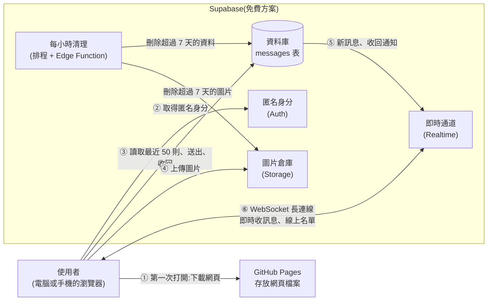

# 匿名聊天室 架構文件

這份文件寫給不寫程式的人看。專有名詞第一次出現時,會用一句話解釋。

## 1. 專案說明與目標

**這是什麼**:一個不用註冊、不用登入的匿名聊天室。所有人在同一個聊天室裡。任何知道網站連結的人,用電腦或手機都能進來。

**使用者會做的事**
1. 打開網頁,輸入一個代號(1 到 12 個字)。
2. 進入聊天室,看到最近 50 則訊息。
3. 送出文字(最多 200 字),可以附一張圖片(最大 2 MB)。
4. 看到誰在線上,有人進來或離開時看到一行提示。
5. 可以收回自己送出的訊息,收回後所有人的畫面都會消失。

**目標**
- 先做好前端,放在 GitHub Pages 上看得到成果,最後才接上 Supabase。
- 不花錢:全部使用免費方案。
- 訊息和圖片只保留 7 天,之後自動刪除。

**已經決定的使用細節**

| 項目 | 決定 |
|---|---|
| 代號 | 線上已有人用同一個代號時,後來的人要換一個。瀏覽器記住上次的代號並自動填好,但仍要按一下才進入 |
| 版面 | 自己的訊息靠右,別人的靠左。每個代號有固定的顏色。每則訊息顯示代號和時間 |
| 線上名單 | 電腦在畫面右側固定顯示。手機收起來,點上方「N 人在線上」才展開 |
| 新訊息 | 你停在最底下時自動捲到底。你往上看舊訊息時畫面不動,右下角出現「有新訊息」按鈕 |
| 斷線 | 畫面上方出現「連線中斷」橫幅。連回來後自動補上漏掉的訊息 |
| 防洗版 | 每個人每 2 秒最多送一則 |
| 外觀 | 溫暖輕鬆的風格,介面用繁體中文,跟隨手機或電腦的深色模式 |

---

## 2. 整體架構圖

三個角色:

- **使用者的瀏覽器**:聊天室的畫面和操作,都在這裡執行。
- **GitHub Pages**:GitHub 提供的免費網頁空間。它只負責「把網頁檔案交給瀏覽器」,不會處理任何聊天內容。
- **Supabase**:一個現成的後端服務(幫你保管資料、傳遞即時訊息的伺服器)。聊天內容都經過它。



**WebSocket** 是一種「瀏覽器和伺服器之間一直開著的連線」。一般網頁是「問一次、答一次」;WebSocket 讓伺服器可以主動把新訊息推給你,所以別人一送出,你的畫面立刻就會出現。

重點:GitHub Pages 只在你打開網頁時出現一次。之後所有聊天內容,都是瀏覽器直接和 Supabase 溝通,不經過 GitHub Pages。

---

## 3. 技術選擇

每一項寫「選了什麼」和「為什麼」。

### 3.1 前端

| 項目 | 選了什麼 | 為什麼 |
|---|---|---|
| 語言 | **TypeScript** | 它是 JavaScript(瀏覽器唯一能執行的程式語言)的加強版,會在寫程式時就檢查資料格式對不對。聊天室有很多固定格式的資料(訊息、使用者),寫錯欄位名稱時能提早發現,不用等到使用者遇到才知道 |
| 框架 | **React** | 框架是「蓋網頁的工具組」。這個畫面有很多會即時變動的部分(新訊息、線上名單、連線狀態)。React 的做法是:資料變了,畫面自動跟著更新,不用手動去改每個地方。使用者多、教學多,遇到問題容易找到答案 |
| 打包工具 | **Vite** | 把我們寫的許多程式檔,整理成 GitHub Pages 能放的「靜態檔案」(內容固定、不需要伺服器運算的檔案)。速度快、設定少 |
| 樣式 | **純 CSS** | CSS 是控制網頁外觀的語言。不引入額外的套件,檔案小、載入快。顏色和樣式由 `/design` 決定 |

不選的理由:不用 Next.js 之類需要伺服器的框架,因為 GitHub Pages 只能放靜態檔案。

### 3.2 後端:Supabase 的哪些功能

| Supabase 功能 | 用來做什麼 | 為什麼選它 |
|---|---|---|
| **匿名登入**(Anonymous Sign-ins) | 使用者不用註冊,但每個瀏覽器會自動拿到一個看不見的身分編號 | 需要這個編號,系統才知道「這則訊息是你送的,你可以收回」,也才能限制「同一個人 2 秒只能送一則」。使用者完全不會感覺到 |
| **資料庫**(Database) | 用一張 `messages` 表存所有訊息,並用「列級權限規則」(Row Level Security,簡稱 RLS:規定每個人能讀、寫、刪哪幾筆資料的規則)控管 | 需求要「新人看得到最近 50 則」和「斷線後補訊息」,所以訊息必須存下來,不能只轉發 |
| **即時通道**(Realtime) | 把新訊息、收回通知、線上名單即時推給所有人 | 你已經指定用 Supabase 的 WebSocket。它有兩種用法,我們都用到:資料變動通知(有新訊息、有訊息被刪)和「在線狀態」(Presence,誰現在連著) |
| **圖片倉庫**(Storage) | 存使用者上傳的圖片 | 圖片太大,不適合塞進資料庫。Storage 可以限制單檔大小和檔案類型 |
| **排程 + Edge Function** | 每小時自動刪除超過 7 天的訊息和圖片 | Edge Function 是「放在 Supabase 上、可以被呼叫的小程式」。只刪資料庫紀錄的話,圖片檔會留在倉庫變成垃圾,所以要用小程式一起刪 |

**不選的做法**:只用 Realtime 的「廣播」功能(Broadcast,訊息傳完就消失、不留紀錄),因為它做不到歷史訊息和補訊息。

### 3.3 其他

- **部署**:GitHub Actions(GitHub 提供的自動化功能,你推送程式後它會自動打包、上傳),見第 12 節。
- **版本控制**:Git / GitHub,已經有了。

---

## 4. 兩個階段

### 階段一:還沒接 Supabase

**前端要能做到什麼程度**:所有畫面、所有操作都能用,只是聊天對象是「假的」。具體來說:

- 輸入代號、進入聊天室。
- 載入一段預先寫好的 50 則假歷史訊息。
- 程式在背景模擬幾個假使用者,隔一段時間就說話、進來、離開。
- 自己送出的文字和圖片,會顯示在自己的畫面上(只存在瀏覽器記憶體,重新整理就消失)。
- 可以收回自己的訊息。
- 可以測試的「異常情況」:有個開發用的小按鈕(只在階段一出現),可以模擬「斷線」「送出失敗」「代號被占用」,這樣才看得到那些提示長什麼樣子。
- 手機版與電腦版版面、深色模式、「有新訊息」按鈕,都能實際操作。

**怎麼在 GitHub Pages 看得到**:每次把程式推送到 GitHub 的 `main` 分支,自動打包並發佈。你打開 `https://<你的帳號>.github.io/<repo 名稱>/`,就能在電腦或手機上實際點擊、操作。細節見第 12 節。

階段一的限制:只有你自己一個真人,看不到「兩個真人互相聊天」的效果。

### 階段二:接上 Supabase

改變的只有「資料從哪來、送到哪去」:

| 項目 | 階段一 | 階段二 |
|---|---|---|
| 歷史訊息 | 預先寫好的假資料 | 從資料庫讀最近 50 則 |
| 其他人 | 程式模擬的假使用者 | 真人 |
| 送出訊息 | 只存在自己瀏覽器 | 寫進資料庫,所有人即時收到 |
| 線上名單 | 假資料 | 即時通道的在線狀態 |
| 代號重複檢查 | 假裝某幾個代號被占用 | 真的檢查目前線上的人 |
| 圖片 | 只存在瀏覽器記憶體 | 上傳到圖片倉庫 |
| 防洗版 | 只在前端擋 | 前端擋,並且資料庫也擋 |
| 7 天清理 | 沒有 | 每小時自動執行 |
| 斷線與補訊息 | 開發用按鈕模擬 | 真實的網路中斷與重連 |

### 兩個階段之間,前端怎麼設計才不用重寫

做法:**把「畫面」和「資料來源」分開,中間用一份固定的「合約」連接。**

- 畫面只認得一份叫做「聊天服務」(ChatService)的合約。合約規定了有哪些功能:進入、離開、讀歷史、送出、收回、訂閱新事件(詳見第 5 節)。
- 畫面從來不知道資料是真的還是假的,它只呼叫合約上的功能。
- 階段一:有一個「假服務」照合約提供功能。
- 階段二:另外寫一個「Supabase 服務」,照同一份合約提供功能。
- 切換的時候,只改一個地方:「現在用哪一個服務」。畫面程式一行都不用改。

這個合約,就是第 5 節的「通訊約定」。**假服務和真服務發出的事件名稱、資料格式必須完全一樣**,這是這個設計能成立的關鍵。

---

## 5. 通訊約定

畫面和「聊天服務」之間,透過兩種方式溝通:畫面「呼叫功能」、服務「發出事件」。

### 5.1 畫面可以呼叫的功能

| 功能 | 做什麼 | 可能失敗的原因 |
|---|---|---|
| 進入(join) | 帶著代號進入聊天室 | 代號不合規定、代號已被占用、聊天室已滿、連不上 |
| 離開(leave) | 離開聊天室 | (不會失敗) |
| 讀最近訊息(loadRecent) | 取得最近 50 則 | 連不上 |
| 讀某時間之後的訊息(loadSince) | 斷線重連後,補上漏掉的 | 連不上 |
| 送出(send) | 送出文字,可附一張圖片 | 太快、太長、圖片不合規定、連不上 |
| 收回(retract) | 收回自己的某則訊息 | 不是自己的訊息、連不上 |

### 5.2 服務會發出的事件

| 事件名稱 | 什麼時候發出 | 畫面要做什麼 |
|---|---|---|
| `message:new` | 有人(包含自己)送出新訊息 | 加到訊息列表 |
| `message:retracted` | 有人收回訊息 | 從列表移除那一則 |
| `presence:join` | 有人進入聊天室 | 加進線上名單,插入一行「某某 進來了」 |
| `presence:leave` | 有人離開或斷線 | 從線上名單移除,插入一行「某某 離開了」 |
| `presence:sync` | 剛進入或重連後,取得目前完整的線上名單 | 整份名單換掉,不顯示進出提示 |
| `connection:lost` | 網路斷了 | 顯示「連線中斷」橫幅 |
| `connection:restored` | 網路恢復,並已補上漏掉的訊息 | 移除橫幅 |

### 5.3 資料格式

**訊息(Message)**

| 欄位 | 意思 | 範例 | 規則 |
|---|---|---|---|
| `id` | 這則訊息的唯一編號 | `"a1b2…"` | 系統產生 |
| `userId` | 送出者的隱形身分編號 | `"u-93f…"` | 系統產生。畫面用它判斷「是不是我送的」(決定靠左或靠右、有沒有「收回」按鈕) |
| `nickname` | 送出者的代號 | `"小明"` | 1 到 12 個字 |
| `text` | 文字內容 | `"大家好"` | 最多 200 字。可以沒有,但文字和圖片至少要有一個 |
| `imageUrl` | 圖片網址 | `"https://…/x.png"` | 可以沒有 |
| `createdAt` | 送出時間 | `"2026-10-13T08:30:00Z"` | 由伺服器記錄,不用使用者的手機時間(手機時間可能不準) |

**線上使用者(PresenceUser)**

| 欄位 | 意思 | 範例 |
|---|---|---|
| `userId` | 隱形身分編號 | `"u-93f…"` |
| `nickname` | 代號 | `"小明"` |

**錯誤(ChatError)**:每個失敗都有一個固定的代碼,畫面依代碼顯示中文提示。

| 代碼 | 畫面顯示 |
|---|---|
| `NICKNAME_INVALID` | 代號要 1 到 12 個字 |
| `NICKNAME_TAKEN` | 這個代號有人在用了 |
| `ROOM_FULL` | 聊天室人數已滿,請稍後再試 |
| `RATE_LIMITED` | 請稍等一下 |
| `TEXT_TOO_LONG` | 訊息最多 200 字 |
| `IMAGE_TYPE` | 只能傳 JPG、PNG、GIF |
| `IMAGE_TOO_BIG` | 圖片不能超過 2 MB |
| `NETWORK` | 連線失敗 |

---

## 6. 資料流

下面每一段,都是「使用者做了某件事之後,系統內部依序發生什麼」。

### 6.1 進入聊天室

1. 使用者打開網頁。瀏覽器從 GitHub Pages 下載網頁檔案。
2. 畫面顯示「輸入代號」。如果瀏覽器記得上次的代號,自動填好。
3. 使用者按「進入」。畫面先檢查長度(1 到 12 個字、不能全是空白)。不合規定就直接提示,不連線。
4. 服務向 Supabase 取得匿名身分(第一次來才需要,之後瀏覽器會記住)。
5. 服務連上即時通道,查看目前線上有誰。如果已經有人用這個代號,回報 `NICKNAME_TAKEN`,畫面提示換一個,流程停在這裡。
6. 沒有重複,服務把自己的代號登記到在線狀態,並記在瀏覽器裡(下次自動填)。
7. 服務讀取最近 50 則訊息,畫面顯示並捲到最底。
8. 其他人的畫面收到 `presence:join`,出現「某某 進來了」。

### 6.2 送出訊息

1. 使用者輸入文字,或選圖片(也可貼上、拖進輸入框)。
2. 畫面先檢查:文字不能超過 200 字、不能空白;圖片必須是 JPG/PNG/GIF 且不超過 2 MB;距離上一則不到 2 秒就提示「請稍等一下」。不合規定就停下,不送出。
3. 有圖片的話,先上傳到圖片倉庫,取得圖片網址。
4. 把訊息(代號、文字、圖片網址)寫進資料庫。資料庫會再檢查一次:長度、欄位完整、2 秒限制。任何一項不符就拒絕。
5. 資料庫通知即時通道,所有人(包含自己)收到 `message:new`。
6. 每個人的畫面把訊息加進列表。是自己送的就靠右,別人送的靠左。
7. 如果第 3 或 4 步失敗(例如網路斷了),那則訊息留在自己的畫面上,標示紅色和「重送」按鈕,其他人看不到它。

### 6.3 收回訊息

1. 使用者對自己的訊息按「收回」(別人的訊息沒有這個按鈕)。
2. 如果訊息有圖片,先從圖片倉庫刪除圖片檔。
3. 從資料庫刪除該則訊息。資料庫只允許刪除「自己送的」。
4. 所有人收到 `message:retracted`,畫面上那一則消失。

### 6.4 離開聊天室

兩種情況:

- **主動離開**(按「離開」按鈕):服務退出即時通道,畫面回到「輸入代號」。
- **直接關掉分頁或手機鎖屏太久**:瀏覽器來不及通知任何人。Supabase 會在一小段時間後發現這個人沒有回應,自動把他從在線名單移除。

兩種情況,其他人的畫面都會收到 `presence:leave`,出現「某某 離開了」。差別只是「後者會晚幾秒」。

### 6.5 斷線重連

1. 網路中斷。服務發出 `connection:lost`,畫面上方顯示「連線中斷,重新連線中…」。使用者仍可以看舊訊息。
2. 斷線期間送出的訊息,標示為失敗並顯示「重送」。
3. 網路恢復後,Supabase 的連線工具會自動重連。
4. 服務用「斷線前收到的最後一則訊息的時間」,呼叫 `loadSince`,把漏掉的訊息補回來(已經有的不會重複加入)。
5. 服務重新登記在線狀態,並送出 `presence:sync`(整份名單換掉,**不會**對每個人都顯示進出提示)。
6. 服務發出 `connection:restored`,橫幅消失。
7. 如果重連時發現自己的代號已被別人占用(斷線期間被搶走),回到「輸入代號」畫面並提示。

---

## 7. 畫面清單

這一節只寫「有什麼元素、做什麼事」,不規定顏色、字體、圖示樣式。那些由 `/design` 決定。

共 2 個主要畫面,外加 1 個全畫面通用的提示。

### 7.1 畫面一:輸入代號(JoinScreen)

**元素**
- 聊天室名稱和一句簡短說明。
- 代號輸入框。如果瀏覽器記得上次的代號,預先填好。
- 「進入」按鈕。
- 錯誤提示區(輸入框下方)。

**行為**
- 輸入時即時顯示字數(例如 3/12)。
- 空白或超過 12 字:「進入」按鈕不能按,或按了顯示 `NICKNAME_INVALID` 提示。
- 按 Enter 等同按「進入」。
- 按下後按鈕顯示「進入中…」並暫時不能再按,避免重複送出。
- 代號被占用:留在這個畫面,顯示 `NICKNAME_TAKEN`,輸入框保留內容讓使用者修改。
- 聊天室已滿或連不上:顯示對應提示,按鈕恢復可按。

### 7.2 畫面二:聊天室(ChatScreen)

由五個區塊組成。

**A. 頂部列**
- 聊天室名稱。
- 「N 人在線上」:手機上是按鈕,點了展開線上名單;電腦上只是文字(名單固定在右側)。
- 「離開」按鈕:按了回到畫面一。
- 連線橫幅(只在斷線時出現)。

**B. 訊息列表**
- 由舊到新往下排。
- 每則訊息顯示:代號(帶該代號的固定顏色)、時間、文字、圖片(如果有)。
- 自己的訊息靠右,別人的靠左。
- 自己的訊息有「收回」按鈕。按下前先跳出確認(避免誤按)。
- 系統提示(進來了、離開了)是置中的一行小字,不是訊息泡泡,也沒有時間以外的其他資訊。
- 圖片:點一下可以放大檢視;圖片載入前先佔好位置,避免載入完把畫面往下擠。
- 送出失敗的訊息:紅色提示加「重送」按鈕。
- 進入畫面時,自動捲到最底。
- 「有新訊息」按鈕:只在使用者往上捲(離底部超過約一個螢幕)而且有新訊息進來時,出現在右下角。點了捲到底,按鈕消失。使用者自己捲回底部,按鈕也消失。
- 沒有任何訊息時,顯示「還沒有人說話,你先開始吧」之類的空狀態。

**C. 線上名單**
- 列出所有在線者的代號(帶固定顏色),自己標示「你」。
- 電腦:固定在右側。手機:點頂部列的「N 人在線上」才展開,再點一次或點外面收起。

**D. 輸入區**
- 多行文字框:按 Enter 送出,Shift+Enter 換行(手機上以送出按鈕為主,Enter 是換行)。
- 字數顯示:接近 200 字時才顯示(例如剩 20 字),超過時送出按鈕不能按。
- 圖片按鈕:開啟檔案選擇。也支援貼上(Ctrl+V)和拖進輸入框。
- 已選圖片預覽:顯示縮圖和「移除」按鈕。一次只能有一張,再選就取代。
- 「送出」按鈕:文字和圖片都沒有時不能按;送出後清空輸入框和圖片。
- 送太快(2 秒內):顯示「請稍等一下」,按鈕暫時不能按。
- 圖片格式或大小不合規定:顯示對應提示,不加入預覽。

**E. 全畫面通用的狀態**
- 連線中斷橫幅(見 A)。
- 被占用代號等需要返回畫面一的情況(見 6.5 第 7 步)。

### 7.3 手機與電腦的差別

| 項目 | 電腦 | 手機 |
|---|---|---|
| 線上名單 | 右側固定 | 收起,點頂部「N 人在線上」展開 |
| Enter 鍵 | 送出訊息 | 換行,用送出按鈕送出 |
| 貼上圖片 | 支援 Ctrl+V 與拖放 | 用圖片按鈕選檔 |
| 版面寬度 | 訊息最寬到適合閱讀的寬度,不鋪滿整個螢幕 | 全寬 |

---

## 8. 金鑰

**金鑰**(key)是一長串字元,像是「進入某個服務的通行證」。這個專案會用到 Supabase 的兩種金鑰,處理方式完全不同。

### 8.1 會用到哪些金鑰

| 名稱 | 白話說明 | 能做什麼 | 可以公開嗎 |
|---|---|---|---|
| **專案網址**(Project URL) | Supabase 幫你的專案分配的網址 | 告訴瀏覽器去哪裡連 | **可以**。它本來就會出現在每個使用者的網路請求裡 |
| **公開金鑰**(anon key,新版介面可能叫 publishable key) | 給瀏覽器用的通行證 | 只能做「列級權限規則」允許的事 | **可以**。它的設計就是公開的 |
| **管理金鑰**(service_role key,新版介面可能叫 secret key) | 資料庫的萬能鑰匙 | 繞過所有權限規則,可以讀寫刪全部資料 | **絕對不行**。外流就等於整個資料庫被別人接管 |

### 8.2 為什麼公開金鑰可以公開

網頁是在每個使用者自己的瀏覽器裡執行的,任何人按右鍵「檢視原始碼」都能看到裡面的所有內容。所以前端**不可能**藏得住任何秘密。

Supabase 的設計是:公開金鑰本來就公開,**真正的保護來自權限規則**(第 3.2 節的 RLS)。規則規定:

- 誰可以讀訊息:所有匿名登入的人。
- 誰可以新增:已登入的人,而且只能用自己的身分。
- 誰可以刪除:只有訊息的作者。
- 誰可以修改:沒有人。

所以就算有人拿到公開金鑰,也只能做這些事。這也代表:**權限規則一定要開、一定要設對**,這是安全的核心。階段二的驗證清單有專門測試它。

### 8.3 怎麼產生、放在哪裡

**產生**:建立 Supabase 專案後,在 Supabase 網站的專案設定頁面(API 設定)就會看到網址和兩種金鑰。不需要自己產生。

**放在哪裡**

| 東西 | 放在哪裡 | 說明 |
|---|---|---|
| 專案網址、公開金鑰 | 你電腦上專案資料夾裡的 `.env` 檔(開發時用);GitHub repo 的 Actions variables(部署時用) | 打包時把這兩個值寫進網頁檔案 |
| 管理金鑰 | **只存在 Supabase 自己的伺服器上**(清理用的小程式 Edge Function 執行時由 Supabase 自動提供),不存在你的電腦、不存在 GitHub | 專案裡完全不需要這個金鑰的副本 |

> **名詞說明**:`.env` 是一個放設定值的純文字檔。Actions variables 是 GitHub repo 設定頁面裡可以填入的設定值,部署時自動帶入。

### 8.4 怎麼避免被 commit 到 GitHub

(commit 是「把檔案存進 Git 紀錄並推送到 GitHub」。一旦推上去,歷史紀錄裡永遠找得到,即使之後刪掉。)

1. **`.gitignore`**:這是一份「Git 不要管這些檔案」的清單。把 `.env` 和 `.env.*` 加進去(但 `.env.example` 除外)。這樣 Git 根本不會把它們納入。
2. **`.env.example`**:提供一份只有欄位名稱、沒有真正數值的範本,告訴別人(或未來的你)要填哪些值。這份可以 commit。
3. **管理金鑰不放在電腦上**:既然專案裡根本沒有它,就不可能被 commit。
4. **第一次推送前檢查**:用 `git status` 確認 `.env` 沒有出現在要提交的清單裡。
5. **萬一管理金鑰外流**:立刻到 Supabase 網站重新產生(舊的馬上失效)。

---

## 9. 安全與限制

### 9.1 別人可能送什麼奇怪的東西進來,前端與資料庫各自怎麼擋

原則:**前端的檢查是為了給使用者好的體驗(馬上提示),資料庫的檢查才是真正的防線**。因為前端的程式在使用者手上,惡意的人可以跳過前端直接對 Supabase 送資料。

| 可能的情況 | 前端怎麼擋 | 資料庫或倉庫怎麼擋 |
|---|---|---|
| 超長的文字 | 超過 200 字不能送出 | 資料表規則:超過 200 字拒絕 |
| 空白或空訊息 | 沒有文字也沒有圖片,不能送出 | 資料表規則:文字和圖片至少要有一個 |
| 超長或空白的代號 | 長度不符不能進入 | 資料表規則:代號 1 到 12 字 |
| 在文字裡夾帶網頁程式碼(例如 `<script>…</script>`,企圖在別人的瀏覽器執行) | **所有文字一律當純文字顯示**,不解析成網頁內容。這是最重要的一條 | 無(不在資料庫改內容,保持原樣,顯示時處理) |
| 圖片偽裝(例如把其他檔案改副檔名成 .png) | 檢查檔案類型,只接受 JPG、PNG、GIF | 圖片倉庫限制允許的檔案類型 |
| 超大的圖片 | 超過 2 MB 不上傳 | 圖片倉庫限制單檔 2 MB |
| 洗版(很快地連續送) | 2 秒內按鈕暫時不能按 | 資料庫規則:同一身分 2 秒內只能新增一則 |
| 冒充別人收回或刪除別人的訊息 | 只在自己的訊息上顯示「收回」按鈕 | 權限規則:只有作者可以刪除 |
| 修改已送出的訊息 | 沒有編輯功能 | 權限規則:沒有人可以修改 |
| 把圖片傳到別人的資料夾、刪別人的圖片 | 無 | 圖片倉庫規則:只能存取以自己身分編號命名的資料夾 |
| 圖片網址指向別的網站(例如追蹤網址) | 無 | 圖片網址只由我們的上傳流程產生,不接受使用者輸入網址 |
| 名稱裡的特殊字元、很怪的符號、同形字 | 一律當純文字顯示;去除頭尾空白 | 無 |
| 一個人開很多分頁、很多身分 | 無法完全擋 | 見 9.3「已知風險」 |

### 9.2 Supabase 免費方案的上限

以下數字是 2026 年 10 月在 Supabase 官網查到的免費方案內容。方案可能調整,正式上線前請再確認一次。

| 項目 | 上限 | 對這個專案的影響 |
|---|---|---|
| **同時連線人數** | 最多 200 人 | **這就是聊天室的人數上限**。第 201 個人連不上,畫面要顯示「聊天室已滿」(`ROOM_FULL`) |
| 即時訊息數量 | 每月 200 萬則 | 聊天室人多時,一則訊息會同時推給每個人,數量會被放大。例如 50 人在線,每人收一則就算 50。流量大時要留意 |
| 即時訊息每秒上限 | 每秒 100 則 | 在線人數少時用不到 |
| 在線狀態更新每秒上限 | 每秒 20 次 | 很多人同一秒進出時,可能短暫延遲 |
| 檔案儲存空間 | 1 GB | 7 天內累積的圖片不能超過這個量。最壞情況(每張都是 2 MB)約 500 張。用量大時可能要把保留天數縮短 |
| 單一檔案上傳上限 | 50 MB | 我們自己限制更嚴格(2 MB),不是問題 |
| 資料庫大小 | 500 MB | 文字訊息很小,7 天內不太可能達到 |
| 對外流量 | 每月 5 GB | **最可能先爆的一項**:每次有人看到圖片,都算流量。圖片多、人多的時候要留意 |
| 免費專案數 | 2 個 | 不影響 |
| **閒置會暫停** | 專案**一週沒有活動就自動暫停** | 沒人用的時候,聊天室會壞掉,要到 Supabase 網站手動恢復。見下方說明 |

**關於「閒置暫停」**:如果聊天室一個星期都沒有人用,Supabase 會把專案暫停。下一個進來的人會遇到連不上。處理方式:到 Supabase 網站按一下恢復。這個版本不做自動防止暫停的機制,但文件記在這裡,免得你發現「怎麼突然壞了」。

**超過上限時會怎樣**:免費方案超過上限時,Supabase 通常會限制功能或要求升級,不會自己開始收費(需要你自己主動升級)。畫面端對應的是:連不上時顯示 `NETWORK` 或 `ROOM_FULL` 的提示。

### 9.3 已知風險(這一版接受)

1. **換身分繞過限制**:匿名登入沒有任何驗證。有心人清掉瀏覽器資料就換成新身分,可以繞過每 2 秒一則的限制,也能用同一個代號在不同時間重複登入。如果真的被濫用,Supabase 可以加上「機器人驗證」(CAPTCHA),之後再做。
2. **不當內容**:沒有檢舉功能。不當文字或圖片,只能由你登入 Supabase 網站手動刪除(資料表在 Table Editor,圖片在 Storage)。在你發現之前,所有人都看得到。
3. **同名搶先**:兩個人在同一瞬間用同一個代號,有極小機率都通過檢查,結果暫時同名。不會損壞資料,第一版接受。
4. **圖片網址公開**:任何拿到網址的人都能看到圖片,不需登入。這樣瀏覽器才能直接顯示圖片。圖片超過 7 天會被刪除。

---

## 10. 這一版刻意不做的事,以及為什麼

| 不做 | 為什麼 |
|---|---|
| 編輯已送出的訊息 | 增加複雜度(要記錄是否被改過、要通知其他人更新),收回後重新送出就能達到同樣目的 |
| 檢舉功能與自動隱藏 | 需要額外的資料表和規則,而且匿名環境下容易被濫用(同一個人用很多身分檢舉)。先用手動刪除 |
| 進出提示存進資料庫 | 「離開」無法可靠記錄(關分頁時沒機會通知伺服器)。所以進出提示只有當下在線的人看得到,新進來的人看不到之前的進出紀錄 |
| 多個聊天室、私訊 | 需求是「所有人在同一個聊天室」 |
| 登入、註冊、使用者資料 | 需求明確不需要 |
| 訊息搜尋、無限往上捲看更舊的訊息 | 只保留最近 50 則供新人查看,簡化資料讀取 |
| 輸入中提示、已讀、推播通知 | 非必要功能,而且會大幅增加即時訊息的數量,更快用完免費額度 |
| 影片、一次多張圖片、其他檔案 | 免費儲存空間有限(1 GB),圖片限制單張 2 MB 已是平衡點 |
| 自動防止專案閒置暫停 | 會增加維運複雜度;先接受「很久沒人用就要手動恢復」 |
| 管理者專用的後台頁面 | 直接使用 Supabase 網站已有的資料管理畫面就夠,不用重複做一套 |
| 圖片壓縮 | 先用 2 MB 上限擋;若儲存空間不夠再考慮 |

---

## 11. repo 的資料夾結構

repo 就是這個專案放在 GitHub 上的整個資料夾。以下是建好之後預期的樣子。這一節只是規劃,現在還沒建立。

```
c3/
├─ docs/
│   ├─ requirements.md         需求說明(已有)
│   └─ architecture.md         這份文件
├─ .github/
│   └─ workflows/
│       └─ deploy.yml          自動打包並發佈到 GitHub Pages 的設定
├─ src/                        前端程式
│   ├─ main.tsx                程式進入點
│   ├─ App.tsx                 決定現在顯示畫面一還是畫面二
│   ├─ components/             畫面的各個零件
│   │   ├─ JoinScreen.tsx      畫面一:輸入代號
│   │   ├─ ChatScreen.tsx      畫面二:聊天室
│   │   ├─ MessageList.tsx     訊息列表(含系統提示、「有新訊息」按鈕)
│   │   ├─ MessageBubble.tsx   單則訊息
│   │   ├─ Composer.tsx        輸入區
│   │   ├─ OnlineList.tsx      線上名單
│   │   └─ ConnectionBanner.tsx 連線中斷橫幅
│   ├─ services/               資料來源(第 4 節說的「合約」與兩個實作)
│   │   ├─ types.ts            通訊約定:事件名稱、資料格式、錯誤代碼
│   │   ├─ ChatService.ts      聊天服務合約
│   │   ├─ mockChatService.ts  階段一:假服務
│   │   ├─ supabaseChatService.ts 階段二:真服務
│   │   └─ index.ts            決定現在用哪一個服務(唯一要改的地方)
│   ├─ lib/                    小工具
│   │   ├─ nickname.ts         代號檢查、依代號算出固定顏色
│   │   └─ image.ts            圖片格式與大小檢查
│   └─ styles/                 樣式
├─ supabase/                   階段二才會出現
│   ├─ migrations/             建立資料表、權限規則、倉庫設定的檔案
│   └─ functions/
│       └─ cleanup/            每小時清理的小程式
├─ public/                     不需處理、直接放上網站的檔案(如網站圖示)
├─ index.html                  網頁入口
├─ package.json                專案設定與用到的套件清單
├─ vite.config.ts              打包設定
├─ tsconfig.json               TypeScript 設定
├─ .env.example                金鑰欄位範本(可 commit)
├─ .env                        真正的設定值(不會 commit)
├─ .gitignore                  Git 要忽略的檔案清單
└─ README.md                   專案簡介與如何啟動
```

---

## 12. 部署到 GitHub Pages 的方式

**GitHub Pages** 是 GitHub 提供的免費靜態網頁空間。你的網頁最後會在 `https://<你的帳號>.github.io/<repo 名稱>/`。

### 流程

1. **打包**:我們寫的程式檔很多,不能直接放上去。Vite 會把它們整理成幾個精簡的檔案(放在 `dist/` 資料夾)。這步叫「打包」(build)。
2. **自動化**:在 repo 裡放一份 `.github/workflows/deploy.yml`。它告訴 GitHub:「每次有人推送程式到 `main` 分支,就自動做以下事情:安裝套件 → 打包 → 把 `dist/` 發佈到 Pages。」
3. **一次性設定**:到 GitHub repo 的 Settings → Pages,把來源(Source)設成「GitHub Actions」。
4. **注入設定值**(階段二):專案網址和公開金鑰存在 repo 的 Settings → Secrets and variables → Actions → Variables。打包時自動帶入。
5. **發佈完成**:約 1 到 2 分鐘後,網址上看得到最新版。

### 需要注意的事

- **網址路徑**:因為網頁在 `.github.io/<repo 名稱>/` 底下,不是網域根目錄,打包設定要告訴 Vite 這個路徑前綴,否則網頁會找不到自己的檔案(畫面變成空白)。
- **只有一個頁面**:聊天室不使用多個網址(沒有 `/chat`、`/login` 之類),所以不會遇到 GitHub Pages 常見的「重新整理就 404」問題。
- **Supabase 允許的來源**:階段二時,要在 Supabase 設定中確認 GitHub Pages 的網址可以連線。
- **快取**:更新後如果在手機看到舊版,重新整理或強制重新載入。

---

## 13. 驗證清單

「完成」的定義:以下每一項都在**真實的網址**(GitHub Pages)上實際操作過,結果符合預期。

### 階段一:純前端(假資料)

**部署**
- [ ] 推送程式到 `main` 後,GitHub Pages 網址約 2 分鐘內顯示新版。
- [ ] 專案裡沒有任何金鑰或 `.env` 被 commit。

**進入**
- [ ] 第一次打開,代號輸入框是空的。
- [ ] 輸入 1 個字、12 個字可以進入;空白、13 個字不能進入並有提示。
- [ ] 進入聊天室後,重新整理頁面,代號輸入框自動填好上次的代號。
- [ ] 輸入「被占用」的假代號,顯示「這個代號有人在用了」,且輸入框內容還在。

**訊息**
- [ ] 進入後看到 50 則歷史訊息,並自動在最底部。
- [ ] 送出文字,出現在自己畫面右側;假使用者的訊息在左側。
- [ ] 輸入 200 字可送出,201 字不能送出。
- [ ] 空白訊息不能送出。
- [ ] 選 JPG、PNG、GIF 圖片可以預覽並送出;選其他格式、超過 2 MB 的圖片會被擋下並有提示。
- [ ] 貼上圖片(Ctrl+V)與拖放圖片都能加入預覽。
- [ ] 預覽的圖片可以移除。
- [ ] 2 秒內連續送出,顯示「請稍等一下」。
- [ ] 自己的訊息可以收回(有確認步驟),收回後消失;別人的訊息沒有收回按鈕。
- [ ] 文字裡輸入 `<b>粗體</b>` 或 `<script>alert(1)</script>`,畫面上顯示的是原文字,不會變粗體也不會執行。

**線上與提示**
- [ ] 線上名單顯示所有人,自己標示「你」。
- [ ] 假使用者進來、離開時,出現置中的灰字提示。
- [ ] 線上人數的數字隨之更新。

**捲動**
- [ ] 停在底部時,新訊息自動捲到底。
- [ ] 往上捲時,新訊息進來畫面不動,右下角出現「有新訊息」。
- [ ] 點「有新訊息」捲到底並消失;自己捲回底部,按鈕也消失。

**異常狀況**(用開發用按鈕模擬)
- [ ] 模擬斷線:出現橫幅;模擬恢復:橫幅消失。
- [ ] 模擬送出失敗:訊息變紅並有「重送」,按了可以成功送出。

**版面**
- [ ] 手機(或瀏覽器切成手機寬度)上:線上名單收起,點「N 人在線上」展開。
- [ ] 手機上 Enter 是換行,用送出按鈕送出。
- [ ] 電腦上名單固定在右側,Enter 送出,Shift+Enter 換行。
- [ ] 切換系統深色模式,畫面跟著變,文字依然清楚。
- [ ] 同一個假代號的顏色永遠一樣。
- [ ] 沒有橫向捲軸,內容不會超出螢幕。

### 階段二:接上 Supabase

**基本連線**
- [ ] 兩個不同裝置(例如電腦和手機)同時進入,互相看得到對方的訊息、圖片,延遲約一兩秒內。
- [ ] 線上名單在兩個裝置上一致;一方關掉分頁後,另一方在數十秒內看到對方離開。
- [ ] 重新整理頁面,仍是同一個身分(自己的訊息仍然靠右、仍能收回)。

**代號**
- [ ] 一台裝置在線上時,另一台用同一代號進入會被擋下並提示。
- [ ] 第一台離開後,同一代號可以使用。

**歷史與保留**
- [ ] 新裝置進入時看到最近 50 則,不多不少(在資料超過 50 則的情況下)。
- [ ] 手動把某則測試訊息的時間改成 8 天前,等清理程式執行後,該訊息和它的圖片都被刪除。

**收回**
- [ ] 收回有圖片的訊息後,兩個裝置畫面上都消失,圖片倉庫裡的檔案也被刪除。

**斷線**
- [ ] 一台裝置斷網(飛航模式)一分鐘,期間另一台送出數則訊息;恢復網路後,補上漏掉的訊息,且沒有重複。
- [ ] 斷網期間送出的訊息顯示失敗與「重送」,恢復後重送成功。
- [ ] 斷網期間代號被另一台搶走時,恢復後回到輸入代號畫面並有提示。

**防線(這些要「繞過前端」直接測)**
- [ ] 用瀏覽器開發者工具,直接對資料庫送出 201 字的訊息,被拒絕。
- [ ] 直接對資料庫連續兩秒內送兩則,第二則被拒絕。
- [ ] 直接嘗試刪除別人的訊息,被拒絕。
- [ ] 直接嘗試修改任何訊息,被拒絕。
- [ ] 直接上傳 3 MB 的圖片或 .txt 檔到圖片倉庫,被拒絕。
- [ ] 直接嘗試刪除別人資料夾裡的圖片,被拒絕。
- [ ] 在網站原始碼、GitHub 儲存庫、打包後的檔案中搜尋,**找不到管理金鑰**。

**限額與錯誤**
- [ ] 模擬聊天室已滿(或確認錯誤代碼對應),畫面顯示「聊天室已滿」。
- [ ] Supabase 專案暫停時,網站顯示連線失敗的提示,而不是空白或當掉。

**管理**
- [ ] 能在 Supabase 網站手動刪除一則不當訊息及其圖片,所有人的畫面上該訊息消失(或重新整理後不見)。
